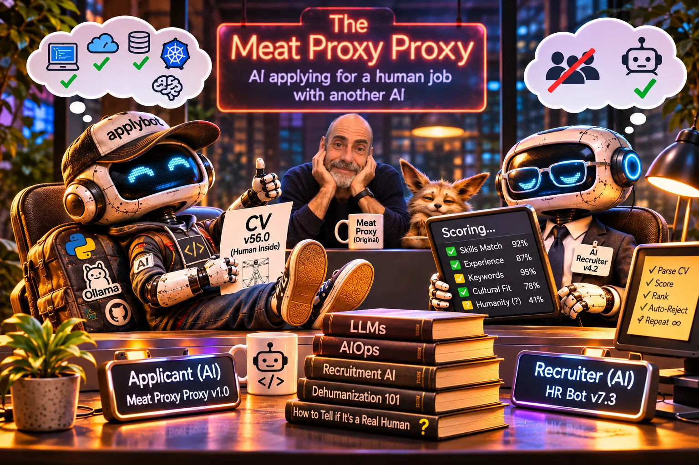

# applybot

<p align="center">
  
</p>

<p align="center"><em>applybot, a.k.a. The Meat Proxy Proxy</em></p>

[](https://github.com/brunooffs/applybot/actions/workflows/ci.yml)
[](LICENSE)

Local, review-first job search assistant for one person. Finds postings,
scores them against a verified profile, picks the right CV, drafts a
grounded cover letter, fact-checks it, and puts it in a queue for you to
approve. Nothing is sent without `applybot send --yes`.

Everything runs on your machine. The only network calls are to the job boards
you list and to the LLM you choose: a fully local one via [Ollama](https://ollama.com)
(no data leaves your computer), or optionally a hosted API. Your personal data
(facts, profile, settings, CVs, database) stays in git-ignored files and is
never part of the repository.

```
sources -> prefilter -> LLM extraction -> deterministic decision -> CV pick
        -> letter draft -> numeric guard + LLM fact-check -> review queue
        -> approve (packet in outbox/) -> send (optional, SMTP)
```

Full design, data model, decision rules and roadmap: [docs/ARCHITECTURE.md](docs/ARCHITECTURE.md).

**Try it without sending anything:** `pbpaste | applybot try -` (macOS: copy a
job posting first; on Linux use `xclip -o | applybot try -`) shows which CV would be chosen, the score and reasons, and
the drafted letter. It stores and sends nothing.

## Install

**macOS or Linux** (open Terminal):

```bash
curl -LsSf https://raw.githubusercontent.com/brunooffs/applybot/main/install.sh | sh
```

**Windows** (open PowerShell):

```powershell
irm https://raw.githubusercontent.com/brunooffs/applybot/main/install.ps1 | iex
```

The script installs [uv](https://docs.astral.sh/uv/) if you don't have it (it asks first),
installs applybot with a suitable Python, creates your private folder and runs
`applybot doctor`. It does not install Ollama or download any model. The scripts are short;
[read them first](install.sh) if you prefer. Running it again updates applybot and keeps your files.

Already have `uv` or `pipx`? `uv tool install git+https://github.com/brunooffs/applybot`, then `applybot init`.

Your personal files live in **`~/.applybot`** (on Windows `C:\Users\<you>\.applybot`): `config/`,
`cvs/`, the database in `data/` and approved packets in `outbox/`. Set `APPLYBOT_HOME` or pass
`--home` to use another folder. Nothing personal is ever inside the installed package or this repository.

Then:

1. Build `config/facts.yaml`: on the dashboard's **Facts** page upload your CV (PDF, DOCX or text) and review
   what the model proposes, or edit the file by hand. Either way, resolve every `TODO` and `CONFIRM`. This file
   is the only thing letters may draw from.
2. Describe yourself and your target roles in `config/profile.yaml`
   (including `work_eligibility`, where you can work without a visa). The dashboard's **Profile** page can start it
   from your CV and, if you like, a cover letter: it proposes a headline, job families and capabilities, asks you where
   you may work and what you want, and fills in your CV list and job-title keywords. Nothing is written until you save. The Overview page shows your current criteria, facts and profile in collapsible panels.
3. Put your CVs in `cvs/` (names in `cvs/cvs.yaml`). `applybot cvs` shows what
   is missing and which job families have no CV.
4. Pick the models in `config/settings.yaml`, or on the dashboard's Models page: `ollama`
   (local, fully open source) or `anthropic` (hosted, needs `ANTHROPIC_API_KEY`).
5. Run `applybot doctor`. It checks the steps above, reads your computer's memory and chip,
   tells you whether a local model is realistic and prints the exact `ollama pull` command to run.
   It never installs or downloads anything itself.
6. `applybot serve --open`, then add your company boards on the Sources page.

### Local models (Ollama)

Install Ollama yourself from [ollama.com/download](https://ollama.com/download), then run the
`ollama pull` command `applybot doctor` suggests for your machine. As a rule of thumb, a local model
is fine for scoring on 16 GB or more, but a hosted model writes better letters and catches more
invented claims. Mixing is supported (for example scoring on Ollama, letters and fact-check on Anthropic).

### From a source checkout (developers)

```bash
python -m venv .venv && source .venv/bin/activate     # Windows: .venv\Scripts\activate
pip install -e ".[dev]"
python -m pytest            # no network needed
applybot init
```

A checkout that already has `config/facts.yaml` in the repository folder keeps using that folder.
The templates live in `src/applybot/defaults/`.

## Daily use

```bash
applybot run --limit 30     # ingest + score + draft
applybot queue              # drafts waiting, best first ("!" = failed verification)
applybot show <id-prefix>   # posting, reasons, letter, verification issues
applybot edit <id-prefix>   # fix the letter in $EDITOR
applybot approve <id-prefix># builds outbox/<job>/ with letter.md, job.md, CV copy
applybot send               # dry-run; add --yes to send (needs contact email in the posting)
applybot stats
```

## Dashboard (optional)

```
applybot serve --open        # http://127.0.0.1:8765, Ctrl-C to stop
```

Sources (add and check Greenhouse/Lever/Ashby tokens and Remotive categories), Run (fetch, score and draft in the background with progress, a stop button and a minimum score for drafting), paste-a-posting (`try`), the review queue with an editor, approve/reject, a
confirmation page before every send, and the inbox with reply drafts. It calls
the same code as the commands above, so the same checks apply (fact-check, CV
file must exist, daily cap). It only answers on your own computer.

Start it from the terminal where `APPLYBOT_MAIL_PASS` (and `ANTHROPIC_API_KEY`,
if used) are exported, otherwise sending and "Check replies" will fail. New
postings still come from `applybot run`.

## Mail (your own SMTP/IMAP account)

Settings are in `config/settings.yaml` under `mail`. The password is only ever
read from the environment:

```bash
export APPLYBOT_MAIL_PASS='...'     # never put it in a file in this repo
```

```bash
applybot send --yes         # SMTP over SSL (465); daily cap + spacing; copies to Sent via IMAP
applybot replies            # read-only IMAP poll -> match replies -> classify -> draft
applybot inbox              # replies waiting for you ("needs_you" = yours to answer)
applybot inbox 3            # read one, with its draft
applybot reply-edit 3       # write/fix the reply in $EDITOR
applybot reply 3 --yes      # send it, threaded (dry-run without --yes)
```

Replies are matched by Message-ID threading to mail applybot sent, so the rest
of your inbox is never read into the database. Anything mentioning salary,
rates, notice period, availability, visa/authorisation or relocation is
escalated to `needs_you` and never drafted. Recruiters who write to you first
are not handled yet.

## Design rules

- The LLM extracts; plain code decides (`scoring.decide`). A high score can
  never hide an unmet disqualifying requirement.
- "Met" only counts if the basis is real: independent-project experience does
  not satisfy "professional experience".
- Unmapped family, selective family, on-site, unclear location eligibility,
  unconfirmable hard requirement: always human review.
- Letters: only `facts.yaml`; every number must appear in facts or the posting;
  a second LLM pass checks each claim. Failing letters are `needs_edit`.
- Never auto-answers application-form questions on years, certifications,
  clearance or work authorisation.
- `auto_send_enabled` is false. `auto_eligible` is a label for now.

## Not built yet

- ATS form filling (headless Playwright), most postings have no email address.
- Reading recruiter replies and drafting responses.
- Source adapters beyond Greenhouse and Remotive are tested against documented shapes only (Greenhouse and Remotive were checked live).
- HN "Who is hiring" source.

## Known limitations

- Postings whose location names only places outside your authorised regions ("Remote US") are dropped at fetch time, before any model call (switch off with `prefilter.skip_unreachable_locations: false` in `criteria.yaml`). Requirements that appear only in the posting text, such as US citizenship or work authorisation, are caught by the scoring step, which must quote the posting to reject.
- Location eligibility is configured in `profile.yaml` (`work_eligibility`: home
  country, authorised regions, accepts relocation). The job's location string is
  read by plain code first (`eligibility.py`), the model only decides what that
  cannot. The country and region lists are not exhaustive; additions welcome.
- A letter with fact-check flags cannot be approved. The checks include a
  plain-code test for wording copied from the posting that your facts do not contain.
- Lever and Ashby adapters are tested against documented response shapes only,
  not yet verified against live endpoints.
- LinkedIn and Indeed are deliberately not supported (terms of service).

## Responsible use

applybot is a drafting and review tool. `auto_send_enabled` is off by default,
every application goes through your approval, and letters may only state facts
you wrote in `facts.yaml`. You are responsible for what you send and for
following each job site's terms of service.

## Contributing and license

Issues and pull requests are welcome, see [CONTRIBUTING.md](CONTRIBUTING.md).
Report security problems as described in [SECURITY.md](SECURITY.md).
Released under the [MIT License](LICENSE).